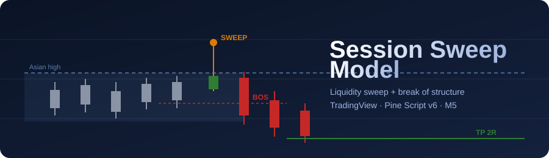
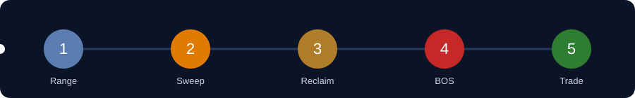
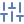

  

  
  
  
  
  

  <b>Liquidity sweep + break of structure signals for Forex, Gold and NAS100</b> 
  Session ranges · Entry, SL and TP drawn on chart · Telegram-ready alerts

>  Educational tool only, not financial advice. Trading carries substantial risk of loss.

---

##  How it works

  

| Step | | What happens |
|---|---|---|
| 1 |  **Range** | The session reference range is built (Asian for London, London for New York). |
| 2 |  **Sweep** | Price trades beyond the range high or low inside the trading window. |
| 3 |  **Reclaim** | Price closes back inside the range within N candles (default 4). |
| 4 |  **BOS** | Price closes through the last opposite swing within N candles (default 12). |
| 5 |  **Trade** | Stop beyond the sweep extreme plus buffer, take profit at 2R (default). |

Setups with a stop larger than 3x ATR(14) are skipped. If both sides of the range are swept, no trade is taken. One position at a time.

##  Sessions

| Window | Time | Instruments | Reference |
|---|---|---|---|
| London | 08:00-11:00 London | Forex, Gold | Asian range |
| New York | 09:30-11:30 New York | Gold, NAS100 | London range |

Times are computed in their home time zones, so daylight-saving changes are handled automatically. **Hard close at 22:00 SAST**: open trades are closed and pending orders cancelled.

##  Installation

1. Open TradingView and the **Pine Editor**.
2. Paste the contents of [`session-sweep.pine`](session-sweep.pine) and click **Add to chart**.
3. Switch to the **M5** timeframe (the stats panel warns if you are on another).

##  Settings

- **Instrument profile**: auto-detects Gold, NAS100 or Forex; can be overridden.
- **Entry type**: Market (default), Limit at the BOS level, or Stop beyond the BOS candle.
- **Reward:Risk, pending expiry, max stop (x ATR), reclaim and BOS candle limits, hard close hour.**
- **Stop buffers**: Forex pips, Gold dollars, NAS100 points.
- **Display**: ranges, window shading, sweep/BOS marks, swing points, skipped setups, stats panel.

##  Alerts

- Create an alert on the indicator and choose **Any alert() function call** for signal, fill, TP, SL, cancel and hard-close messages.
- Or use the simple **Session Sweep: BUY / SELL** alert conditions.
- Telegram: set the format to *Telegram JSON*, enter your chat ID and use the Bot API `sendMessage` URL as the webhook. Full guide in the [Wiki](https://github.com/kxngHADES/Session-Sweep-Model/wiki/Telegram-Bot-Setup).

##  Wiki

| Guide | |
|---|---|
| [How to trade it](https://github.com/kxngHADES/Session-Sweep-Model/wiki/How-to-Trade-It) | Rules, entries, risk, examples |
| [Telegram bot setup](https://github.com/kxngHADES/Session-Sweep-Model/wiki/Telegram-Bot-Setup) | Signals straight to your channel |
| [Settings reference](https://github.com/kxngHADES/Session-Sweep-Model/wiki/Settings-Reference) | Every input explained |
| [FAQ and troubleshooting](https://github.com/kxngHADES/Session-Sweep-Model/wiki/FAQ-and-Troubleshooting) | Common problems |

##  Not automated

Check by hand: high-impact news, spread, firm-wide loss limits, and the EURUSD/GBPUSD "first pair only" rule.

The stats panel is a simulation on chart history (SL wins if SL and TP are hit in the same candle). It is not a guarantee of future results.

##  Releases and contributing

See [CHANGELOG.md](CHANGELOG.md) and [CONTRIBUTING.md](CONTRIBUTING.md).

##  License

Proprietary, all rights reserved. Personal, non-commercial use only. You may not sell, resell, redistribute or re-publish this indicator. See [LICENSE](LICENSE).
